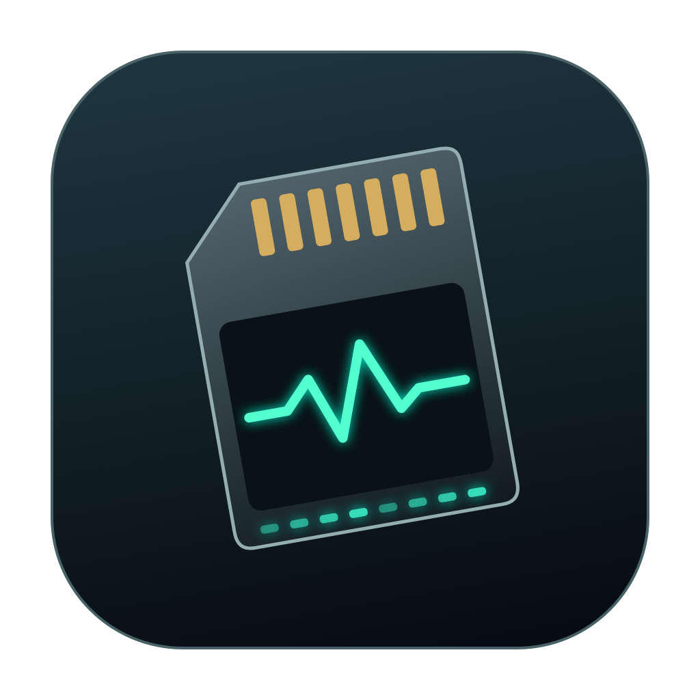

# SidePulse

A native macOS companion for the SidePulse Pro SD card and SidePulse Dot USB device. Follow coding sessions from the menu bar, preview an animation on a virtual LED strip, or drive the lights on your desk. Requires macOS 14 or later.

[Download the Mac app](https://github.com/unipheas/SidePulse-Swift/releases) · [LED programming language](LEDS_FORMAT.md) · [Port coverage](PORTING.md) · [Testing](TESTING.md)

## Try it

1. Unzip the release and drag **SidePulse** into Applications. The 0.2.1 release is Developer ID signed and notarized. You can also build it locally.
2. Open the app and connect a SidePulse. **Overview** shows the detected model, firmware, and current agent state.
3. In **Settings**, set **Show Done for** to `15` seconds. The display returns to Idle when the timer expires and other agents are quiet.
4. If you already run SidePulse, Swift previews its hook events and reads your existing animation settings. Click **Use this installation for device output** when you want to try the native writer. **Restore previous installation** hands the lights back. On a fresh setup, the welcome panel offers agent hooks, background monitoring, Pro eject protection, opening at login, and the optional sleep helper. Follow the provider's normal hook trust prompts.

The app writes its settings under `~/Library/Application Support/SidePulse`. Existing Python preferences are read as initial values. A fresh installation defaults to a 20-minute Done hold. Setup is per user.

Use the appearance icon at the top right of the window to choose **Auto**, **Light**, or **Dark**. Auto follows macOS; an explicit choice applies throughout SidePulse and is remembered after relaunch.

## Command line

The app includes a standalone CLI. For the examples below, set a shell variable to its installed path.

```sh
pulse="/Applications/SidePulse.app/Contents/MacOS/sidepulsectl"
"$pulse" devices
"$pulse" agent-monitor status --json
"$pulse" settings done 15
"$pulse" write --dry-run '#30D158 800ms pulse\nrepeat'
"$pulse" firmware version
"$pulse" firmware upgrade --dry-run
"$pulse" --help
```

- **Monitoring.** Hooks for Codex, Claude Code, Cursor, Grok and Junie. Optional Codex and Claude transcript recovery. A headless launch agent is available with `service start`; `service stop` stops it, and `service uninstall` removes the job.
- **Notch lights.** Enable **Show lights beneath the notch** in Settings for a click-through strip. Choose agent status or battery level and adjust brightness. External displays use a narrow strip at the top edge.
- **Animations.** Choose a profile, edit an individual state, import or export a SidePulse profile, and preview it on a two- or eight-LED display. Reusable library animations can be renamed and updated without breaking the states and profiles that reference them. The preview uses the upstream firmware simulator through JavaScriptCore.
- **Hardware.** Mounted-volume LED writes, Pro READ2ME and Dot SPC2 fallback for read-only volumes, battery display, and model-specific firmware package verification. `sdejectguard start` installs an optional per-user eject guard; stop it before intentionally ejecting the Pro.
- **Mobile.** `link` displays a pairing QR code for the SidePulse mobile app. Use `links`, `push --to ID` and `unlink ID` to manage destinations. `relay send` and `relay receive` exchange agent events through a bridge channel.
- **Examples.** `audio-meter` animates input level from the microphone. `fifa-final --score 2-1 --dry-run` previews the scoreboard animation.
- **History.** Export status changes with `history history.csv` or `history history.html`. Export individual hook events and their interpreted status with `audit events.csv` or `audit events.html`.
- **Reply classification.** On supported Macs with Apple Intelligence available, `classify` uses Apple's on-device Foundation Models framework. Add `--json` for the label and raw model output.

## Build

Open `Package.swift` in Xcode or use a Mac with Xcode 16 or later.

```sh
swift test
# Full local suite, including UI automation (requires XcodeGen):
RUN_UI_TESTS=1 RUN_CLASSIFIER_TESTS=1 Scripts/test-coverage.sh
Scripts/package.sh --universal
Scripts/install.sh
open "/Applications/SidePulse.app"
```

The install script registers one copy in `/Applications`, keeps the distribution ZIP, and removes the loose build copy to avoid duplicate search results.

The package script builds both executables, includes their resources and icon, signs the bundle, and creates a ZIP in `dist`. The core uses Swift and Apple frameworks. A small C adapter provides access to the IOKit USB plug-in vtable. The build has no Python dependency. Sparkle provides the native updater; its license is included under `ThirdParty`. Publishing a signed update requires `Scripts/prepare-update.sh` and the release signing key stored in Keychain. The signed feed publishes SidePulse 0.2.1 (build 6); installed apps can use **Check for Updates…**. Release archives use Developer ID signing and Apple notarization; local builds remain ad-hoc signed unless a signing identity is supplied.

## Attribution

This independent port is based on [inteliwear/sidepulse](https://github.com/inteliwear/sidepulse) and the configurable Done duration in [upstream PR #79](https://github.com/inteliwear/sidepulse/pull/79). The bundled LED programs, profiles, LED format reference and firmware simulator come from that MIT-licensed project. The app icon and Swift implementation are part of this repository. See [LICENSE](LICENSE).

### Optional hardware and power controls

The app can preview battery changes when the Mac is plugged in and play lid-open and lid-closed animations. To enable the stronger closed-lid policy, an administrator can run `sudo Scripts/sleep-helper.sh install` and then select a policy in Settings. This installs a rule restricted to two `pmset` commands. Select **Never** before running `sudo Scripts/sleep-helper.sh uninstall`. The app records whether it changed the system setting so it can release its override.

For an unmounted single-FAT FAT12 device, `raw-write /dev/rdiskN --dry-run PROGRAM` checks the existing LED file and geometry. Raw writes require a whole device no larger than 300,000 bytes and preserve its existing allocation. Normal mounted-device writes are the usual path.

### Compatibility options

Custom hook paths are accepted with `agent-monitor install --log-dir DIRECTORY` or `--codex-log PATH` (and equivalent options for the other providers). Monitoring supports `--max-lines` and `--recent-seconds`. Mounted writes accept an explicit `.LED` path or `--file-name NAME.LED`.

`status-bar start --no-start` installs the app launch agent without launching it. `status-bar stop` quits it; `status-bar install-sleep-helper` and `status-bar uninstall-sleep-helper` manage the bundled privileged helper. The eject guard accepts `--scope user`, `system`, or `auto`; system scope requires root. The GUI and normal monitor run in the user's session.

### Optional local MLX classification

Apple Intelligence remains the default classifier. On Apple silicon, the packaged app also includes a Swift/Metal helper for the original MLX model:

```sh
sidepulsectl classify --backend mlx --json "Please approve the draft."
sidepulsectl classify --model mlx-community/Qwen2.5-0.5B-Instruct-4bit "Thanks!"
```

`--model` also accepts an absolute local model directory. The first remote-model use downloads its weights into the user's model cache. No Python runtime is used. Building the helper requires Xcode; `Scripts/package.sh --universal` includes it and the Metal resources. See [TESTING.md](TESTING.md) for coverage and the remaining validation work.
